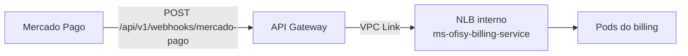

# Deploy no EKS

O ms-ofisy-billing roda em um cluster EKS próprio, com observabilidade pelo Datadog. A infraestrutura vem de outros repositórios:

- `techchallenge-ofisy-eks-infra` (`eks/billing`): cluster `ms-ofisy-billing-cluster`, ECR `ms-ofisy-billing-ecr` e Datadog Agent;
- `techchallenge-ofisy-db-infra` (`billing`): RDS `ms-ofisy-billing-db`, banco `ms_ofisy_billing_db`.

---

## Manifestos

| Arquivo              | Recurso                                                                                       |
|----------------------|-----------------------------------------------------------------------------------------------|
| `k8s/configmap.yml`  | Variáveis não sensíveis: banco, perfil `k8s`, URLs do core e do estoque, Mercado Pago e Datadog |
| `k8s/secret.yml`     | Credenciais do banco, JWT, API Key do Datadog, tokens de serviço e credenciais do Mercado Pago |
| `k8s/deployment.yml` | Pods da aplicação, probes do Actuator, `DD_AGENT_HOST` no IP do nó e tags do Datadog          |
| `k8s/service.yml`    | `LoadBalancer` que cria um NLB **interno** na porta `8080`                                    |
| `k8s/hpa.yml`        | Escala de 2 a 4 réplicas com 50% de CPU                                                       |

Os manifestos têm placeholders que precisam ser substituídos antes do `kubectl apply`:

| Arquivo          | Placeholder                                                                            | Valor                                                                   |
|------------------|----------------------------------------------------------------------------------------|-------------------------------------------------------------------------|
| `configmap.yml`  | `<RDS_ADDRESS>`                                                                        | Endereço do RDS `ms-ofisy-billing-db`                                   |
| `configmap.yml`  | `<CORE_BASE_URL>`, `<STOCK_BASE_URL>`                                                  | `http://<dns-do-nlb-interno>:8080` do core e do ms-ofisy-stock          |
| `configmap.yml`  | `<IMAGE_TAG>`                                                                          | Tag da imagem, usada como `DD_VERSION`                                  |
| `deployment.yml` | `<IMAGE_TAG>` (label `tags.datadoghq.com/version`)                                     | Mesma tag da imagem                                                     |
| `deployment.yml` | `<ECR_REPOSITORY_URL>:<IMAGE_TAG>`                                                     | `<account>.dkr.ecr.us-east-1.amazonaws.com/ms-ofisy-billing-ecr:<tag>`  |
| `deployment.yml` | `<CONFIG_HASH>` (annotation `checksum/config`)                                         | SHA-256 do `configmap.yml` e do `secret.yml` já substituídos            |
| `secret.yml`     | `<BASE64_USERNAME>`, `<BASE64_PASSWORD>`, `<BASE64_JWT_SECRET>`, `<BASE64_DD_API_KEY>` | Valores em base64                                                       |
| `secret.yml`     | `<BASE64_CORE_SERVICE_TOKEN>`, `<BASE64_STOCK_SERVICE_TOKEN>`                          | Tokens de serviço do core e do estoque, em base64                       |
| `secret.yml`     | `<BASE64_MERCADOPAGO_ACCESS_TOKEN>`, `<BASE64_MERCADOPAGO_WEBHOOK_SECRET>`             | Access Token e assinatura secreta do webhook do Mercado Pago, em base64 |

O acesso ao SNS/SQS usa as credenciais da `LabRole` dos nós, sem chaves no manifesto. O HPA depende do Metrics Server no cluster; sem ele, o deployment fica nas 2 réplicas mínimas.

---

## Pelo workflow (padrão)

Rode o workflow **Deploy Manual na AWS (CD)** (`.github/workflows/cd.yml`) informando a branch, tag ou commit. Ele:

1. espera o RDS ficar disponível e busca o endereço dele. Se o banco não existir, o deploy para com erro;
2. encontra os NLBs internos do core (`default/ofisy-service`) e do estoque (`default/ms-ofisy-stock-service`) pela tag `kubernetes.io/service-name` e monta o `CORE_BASE_URL` e o `STOCK_BASE_URL`. Se algum não existir, o deploy para com erro, então core e estoque precisam estar implantados antes;
3. instala o Metrics Server, usado pelo HPA;
4. builda a imagem e envia ao ECR com a tag do commit curto. Se a tag já existir, reaproveita a imagem, porque o ECR não aceita sobrescrever tags;
5. substitui os placeholders dos manifestos, aplica no cluster e espera o rollout. A annotation `checksum/config` recebe o hash do ConfigMap e do Secret, então os pods são recriados quando a imagem ou a configuração mudam, mesmo rodando o CD de novo no mesmo commit.

Usa o environment `AWS_ACADEMY` com os secrets:

| Secret                                                                     | Uso                                        |
|----------------------------------------------------------------------------|--------------------------------------------|
| `AWS_ACCESS_KEY_ID`, `AWS_SECRET_ACCESS_KEY`, `AWS_SESSION_TOKEN`, `AWS_ACCOUNT_ID` | Credenciais do AWS Academy e conta do ECR |
| `DB_PASSWORD`                                                              | Senha do RDS (usuário `admin_db`)          |
| `JWT_SECRET`                                                               | Mesma chave do core                        |
| `DD_API_KEY`                                                               | Métricas do Datadog                        |
| `CORE_SERVICE_TOKEN`, `STOCK_SERVICE_TOKEN`                                | Chamadas síncronas ao core e ao estoque    |
| `MERCADOPAGO_ACCESS_TOKEN`, `MERCADOPAGO_WEBHOOK_SECRET`                   | Orders API e validação do webhook          |

Para remover a aplicação do cluster (por exemplo, antes de destruir o EKS), rode **Destruir Aplicação no Kubernetes (EKS)** (`.github/workflows/destroy-app.yml`).

---

## Manualmente

Com os placeholders substituídos:

```bash
aws eks update-kubeconfig --region us-east-1 --name ms-ofisy-billing-cluster
kubectl apply -f k8s/secret.yml -f k8s/configmap.yml -f k8s/deployment.yml -f k8s/service.yml -f k8s/hpa.yml
kubectl rollout status deployment/ms-ofisy-billing-deployment --timeout=300s
```

---

## Exposição pelo API Gateway e webhook do Mercado Pago

O `Service` cria um NLB interno, então a aplicação não é acessível direto da internet. O único ponto de entrada é o API Gateway do `techchallenge-ofisy-eks-infra`, inclusive para o webhook:



O webhook não passa por JWT nem pelo authorizer de clientes: a aplicação valida a notificação pelo header `x-signature` com o `MERCADOPAGO_WEBHOOK_SECRET`. Depois do primeiro deploy, altere o `api-gateway/` do `techchallenge-ofisy-eks-infra`:

1. em `variables.tf`, inclua o serviço no default de `nlb_service_names`:
   ```hcl
   billing = "default/ms-ofisy-billing-service"
   ```
2. em `main.tf`, inclua as rotas do billing em `local.service_routes`. Sem elas, as requisições continuam caindo no `ANY /{proxy+}`, que vai para o core:
   ```hcl
   "POST /api/v1/webhooks/mercado-pago" = { service = "billing", protected = false }
   "ANY /api/v1/quotes"                 = { service = "billing", protected = false }
   "ANY /api/v1/quotes/{proxy+}"        = { service = "billing", protected = false }
   "PATCH /api/v1/quotes/{id}/approve"  = { service = "billing", protected = true }
   "PATCH /api/v1/quotes/{id}/reprove"  = { service = "billing", protected = true }
   "ANY /api/v1/payments"               = { service = "billing", protected = false }
   ```
   O webhook e as rotas de equipe ficam com `protected = false`, porque a aplicação valida a assinatura do Mercado Pago e o JWT da equipe. Aprovar e reprovar são rotas do cliente e ficam com `protected = true`, atrás do Lambda Authorizer de CPF/CNPJ. Essas duas rotas são mais específicas que o `{proxy+}`, então o API Gateway dá prioridade a elas;
3. rode o deploy do API Gateway;
4. no painel da aplicação do Mercado Pago, configure a URL de notificação como `https://<api-gateway>/api/v1/webhooks/mercado-pago`.

Cada vez que o `Service` é recriado (por exemplo, depois do `destroy-app.yml`), o NLB muda e o deploy do API Gateway precisa rodar de novo. Antes de destruir a aplicação sem recriá-la, tire a entrada `billing` de `nlb_service_names`, senão o próximo deploy do Gateway falha ao procurar o NLB.

---

## Chamadas ao core e ao estoque

Core, estoque e billing ficam em clusters diferentes, então o billing chama os NLBs internos dos outros serviços pela VPC. O security group `ofisy-eks-sg` precisa liberar a porta `8080` para o tráfego vindo dos nós dos outros clusters, além do VPC Link. Se o NLB do core ou do estoque for recriado, rode o CD do billing de novo para atualizar as URLs no ConfigMap.

---

## Observabilidade (Datadog)

- **Traces**: o `dd-java-agent` vem na imagem e é ativado pelo `JAVA_TOOL_OPTIONS` do ConfigMap. Ele envia os traces para o Agent do nó (`DD_AGENT_HOST`, porta `8126`);
- **Rastreamento distribuído**: `DD_TRACE_OTEL_ENABLED=true` no ConfigMap conecta a API do OpenTelemetry ao `dd-java-agent`. É ela que o outbox e o listener usam para manter o fluxo da OS no mesmo trace entre os microsserviços ([MESSAGING.md](MESSAGING.md#rastreamento-distribuído-pelo-outbox));
- **Métricas**: o Micrometer exporta para o Datadog quando `DD_METRICS_ENABLED=true` (só no ConfigMap do k8s);
- **Logs**: no perfil `k8s`, o `logback-spring.xml` escreve JSON com `dd.trace_id` e `dd.span_id`, que o Agent coleta de todos os containers;
- **Health check**: a annotation `ad.datadoghq.com/...checks` configura um `http_check` em `/actuator/health`.