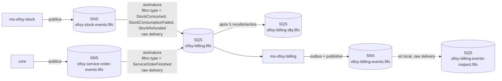
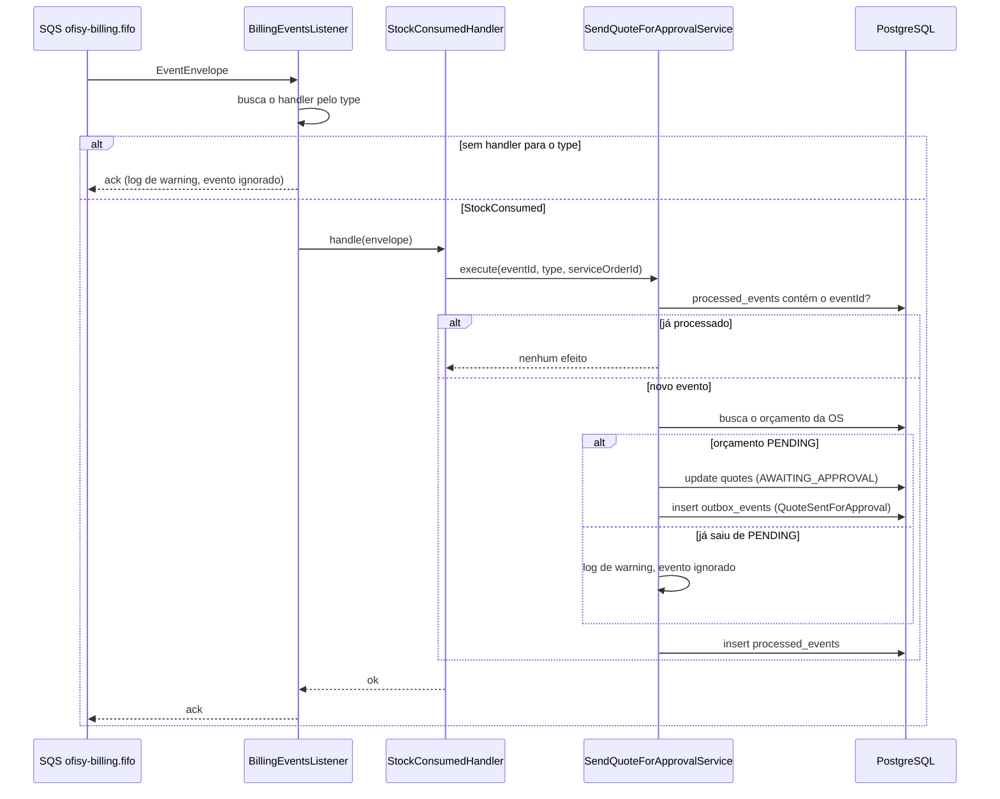
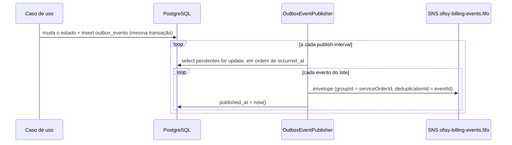
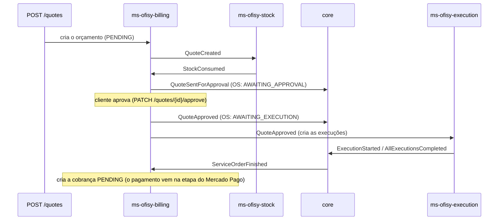

# Mensageria

O ms-ofisy-billing se comunica com os demais microsserviços por eventos, usando **Amazon SNS + SQS** ([ADR-0011](https://github.com/15SOAT-FIAP/techchallenge-ofisy/blob/master/docs/adr/0011-utilizar-sns-e-sqs-como-mensageria.md)), dentro de uma saga por coreografia ([ADR-0012](https://github.com/15SOAT-FIAP/techchallenge-ofisy/blob/master/docs/adr/0012-coordenar-a-saga-por-coreografia.md)). Cada produtor publica no seu próprio tópico, e este ms recebe os eventos que lhe interessam por uma única fila FIFO. Os eventos que ele produz saem por um *transactional outbox* para o tópico `ofisy-billing-events.fifo`.

---

## Topologia



| Recurso          | Nome                                | Observação                                                                                                   |
|------------------|-------------------------------------|--------------------------------------------------------------------------------------------------------------|
| Tópico           | `ofisy-stock-events.fifo`           | Pertence ao ms-ofisy-stock na AWS. Localmente é criado só para exercitar o fluxo                             |
| Tópico           | `ofisy-service-order-events.fifo`   | Eventos da OS, publicados pelo core na AWS. Localmente é criado só para exercitar o fluxo                    |
| Assinaturas      | tópicos → fila                      | Uma por tópico, com `RawMessageDelivery=true` e `FilterPolicy` aplicada ao corpo da mensagem (`MessageBody`) |
| Fila             | `ofisy-billing.fifo`                | Configurada em `ofisy.messaging.queues.billing` (`application.yaml`)                                         |
| DLQ              | `ofisy-billing-dlq.fifo`            | `RedrivePolicy` com `maxReceiveCount=5`                                                                      |
| Tópico           | `ofisy-billing-events.fifo`         | Tópico deste ms, configurado em `ofisy.messaging.topics.billing`                                             |
| Fila de inspeção | `ofisy-billing-events-inspect.fifo` | Só local. Assinada no tópico deste ms para ver o que foi publicado                                           |

Localmente, tudo é criado pelo `localstack/init/ready.d/01-messaging.sh`, que roda quando o LocalStack sobe. Com `queue-not-found-strategy: fail`, a aplicação não inicia se a fila não existir.

Na AWS, os recursos vêm do repositório de infraestrutura. O tópico é configurado pelo **nome**: o `SnsConfig` registra um `TopicsListingTopicArnResolver`, que descobre o ARN listando os tópicos (`sns:ListTopics`) em vez de chamar `CreateTopic`, e guarda o resultado em cache. A aplicação precisa de `sns:ListTopics` e `sns:Publish` e, na fila, de `sqs:GetQueueUrl`, `sqs:ReceiveMessage`, `sqs:DeleteMessage` e `sqs:ChangeMessageVisibility`.

---

## Contrato dos eventos

Todo evento segue o mesmo envelope (`adapters/listeners/dto/EventEnvelope.java`). O `payload` varia conforme o `type`:

| Campo            | Tipo      | Descrição                                                    |
|------------------|-----------|--------------------------------------------------------------|
| `eventId`        | UUID      | Identificador único do evento, usado para idempotência       |
| `type`           | String    | Tipo do evento, usado no filtro da assinatura e no despacho  |
| `serviceOrderId` | UUID      | Ordem de serviço à qual o evento se refere                   |
| `occurredAt`     | Instant   | Momento em que o evento ocorreu no produtor                  |
| `payload`        | JSON      | Dados específicos do tipo de evento                          |

O corpo da mensagem SNS é o envelope inteiro (não só o payload), porque a assinatura filtra pelo campo `type` no **corpo** (RFC-0008).

### Eventos consumidos

| Evento                   | Produtor       | Efeito                                                                                                             |
|--------------------------|----------------|--------------------------------------------------------------------------------------------------------------------|
| `StockConsumed`          | ms-ofisy-stock | Orçamento `PENDING` → `AWAITING_APPROVAL`; publica `QuoteSentForApproval`                                          |
| `StockConsumptionFailed` | ms-ofisy-stock | Orçamento → `CANCELLED`; publica `QuoteCancelled` (motivo `STOCK_UNAVAILABLE`)                                     |
| `StockRefunded`          | ms-ofisy-stock | Orçamento ainda aberto → `CANCELLED`; publica `QuoteCancelled` (motivo `SERVICE_ORDER_CANCELLED`). Sem orçamento, ou já `REPROVED`/`CANCELLED`, é só registrado |
| `ServiceOrderFinished`   | core           | Cria uma cobrança `PENDING` com o total do orçamento aprovado                                                      |

O billing só usa o `serviceOrderId` do envelope nesses quatro eventos: o payload é ignorado, o que evita acoplar este ms ao formato escolhido por quem os produz.

#### `StockConsumed`

O estoque deu baixa nos itens do orçamento. O orçamento só avança se ainda estiver `PENDING`; se já tiver saído desse status (por exemplo, foi cancelado antes da resposta do estoque), o evento é registrado e ignorado.

```jsonc
{
  "eventId": "3f1c2a9e-8d4b-4b7a-9c1e-2f6d5a7b8c90",
  "type": "StockConsumed",
  "serviceOrderId": "c3d4e5f6-a7b8-9012-cdef-123456780001",
  "occurredAt": "2026-11-02T10:00:00Z",
  "payload": { /* definido pelo ms-ofisy-stock; o billing ignora */ }
}
```

#### `StockConsumptionFailed`

O estoque não conseguiu dar baixa (falta de itens). O orçamento vai para `CANCELLED` e o billing publica `QuoteCancelled` com motivo `STOCK_UNAVAILABLE`, o que faz o core cancelar a OS. O envelope é o mesmo do `StockConsumed`, com `type` e `payload` próprios.

#### `StockRefunded`

O estoque devolveu os itens. Acontece em dois caminhos, e o billing trata os dois:

- **OS cancelada** (`ServiceOrderCancelled` → `AllExecutionsCancelled` → `StockRefunded`): o orçamento ainda aberto vai para `CANCELLED` e o billing publica `QuoteCancelled` com motivo `SERVICE_ORDER_CANCELLED`, que é o aviso de que a compensação terminou.
- **OS cancelada antes de existir orçamento** (por exemplo, em `RECEIVED` ou `IN_DIAGNOSTIC`): o execution e o estoque publicam os eventos mesmo sem nada a cancelar nem a devolver, então o `StockRefunded` chega para uma OS sem orçamento. O evento é só registrado, sem `QuoteCancelled`: não há orçamento para cancelar.
- **Orçamento reprovado** (`QuoteReproved` → `StockRefunded`): o orçamento já está `REPROVED`, então o evento é só registrado. O core cancela a OS direto pelo `StockRefunded`, e um `QuoteCancelled` do billing seria um segundo aviso do mesmo fato. O mesmo vale se o orçamento já estiver `CANCELLED`.

O envelope é o mesmo do `StockConsumed`, com `type` e `payload` próprios.

#### `ServiceOrderFinished`

A OS foi finalizada. O billing cria uma cobrança `PENDING` com o total do orçamento, que precisa estar `APPROVED`. A cobrança nasce sem `externalId` nem `checkoutUrl`: a criação no provedor de pagamento fica para a etapa do Mercado Pago. Nenhum evento é publicado de volta.

O envelope é o mesmo do `StockConsumed`, com `type` e `payload` próprios.

### Eventos publicados

Todos saem pelo outbox, descrito em [Publicação de eventos](#publicação-de-eventos-outbox). Mensagem FIFO com `message-group-id = serviceOrderId` e `deduplicationId = eventId`.

| Evento                 | Quando é publicado                                                 | Quem reage                                                                      |
|------------------------|--------------------------------------------------------------------|---------------------------------------------------------------------------------|
| `QuoteCreated`         | Orçamento **com itens de estoque** criado (`POST /quotes`)         | ms-ofisy-stock: dá baixa nos itens (`StockConsumed` / `StockConsumptionFailed`) |
| `QuoteSentForApproval` | Estoque consumido (na criação ou depois de uma edição); ou orçamento só com serviços, direto na criação | core: OS → `AWAITING_APPROVAL` e cria a notificação                             |
| `QuoteUpdated`         | Itens do orçamento editados (`PATCH /quotes/{id}`), em toda edição | ms-ofisy-stock: baixa o que aumentou, devolve o que diminuiu e responde (`StockConsumed` / `StockConsumptionFailed`) |
| `QuoteApproved`        | Cliente aprova o orçamento (rota pública)                          | ms-ofisy-execution: cria as execuções. core: OS → `AWAITING_EXECUTION`          |
| `QuoteReproved`        | Cliente reprova o orçamento (rota pública)                         | ms-ofisy-stock: devolve os itens (`StockRefunded`). core: cancela a OS          |
| `QuoteCancelled`       | Falta de estoque, ou estoque devolvido após o cancelamento da OS   | core: OS → cancelada                                                            |

Os payloads abaixo são os campos que o billing envia hoje. Quem consome é quem define o que precisa.

#### `QuoteCreated`

Só sai quando o orçamento tem itens de estoque: é o pedido de baixa para o ms-ofisy-stock. Orçamento só com serviços não tem o que o estoque consumir e nasce em `AWAITING_APPROVAL`, publicando direto o `QuoteSentForApproval`.

```json
{
  "eventId": "9b2f6c1e-4a7d-4e8b-a1c3-5d6e7f8a9b0c",
  "type": "QuoteCreated",
  "serviceOrderId": "c3d4e5f6-a7b8-9012-cdef-123456780001",
  "occurredAt": "2026-11-02T10:00:00.123456Z",
  "payload": {
    "quoteId": "7a8b9c0d-1e2f-4a3b-8c4d-5e6f7a8b9c0d",
    "stockItems": [
      { "stockId": "d1e2f3a4-b5c6-7890-def1-234567890abc", "quantity": 2 }
    ]
  }
}
```

#### `QuoteSentForApproval`

O orçamento está pronto para o cliente decidir. Sai em dois momentos: ao consumir o `StockConsumed`, ou na criação, quando o orçamento só tem serviços.

```json
{
  "eventId": "1c2d3e4f-5a6b-4c7d-8e9f-0a1b2c3d4e5f",
  "type": "QuoteSentForApproval",
  "serviceOrderId": "c3d4e5f6-a7b8-9012-cdef-123456780001",
  "occurredAt": "2026-11-02T10:00:05.123456Z",
  "payload": {
    "quoteId": "7a8b9c0d-1e2f-4a3b-8c4d-5e6f7a8b9c0d",
    "totalPrice": 150.00
  }
}
```

#### `QuoteUpdated`

Sai em **toda** edição dos itens de um orçamento `AWAITING_APPROVAL`, inclusive quando só os serviços mudaram ou quando todos os itens de estoque foram removidos. O payload traz a lista **completa e atual** dos itens de estoque (não a diferença) e o novo total; `stockItems` vai vazio quando não há itens de estoque, o que para o estoque significa devolver tudo.

Depois da edição o orçamento volta para `PENDING` e espera a resposta do estoque, qualquer que seja a lista. Enquanto está `PENDING` ele não pode ser aprovado, reprovado nem editado de novo. O `QuoteSentForApproval` com o novo total só sai quando o `StockConsumed` chega.

```json
{
  "eventId": "3c4d5e6f-7a8b-4c9d-8e0f-1a2b3c4d5e6f",
  "type": "QuoteUpdated",
  "serviceOrderId": "c3d4e5f6-a7b8-9012-cdef-123456780001",
  "occurredAt": "2026-11-02T10:30:00.123456Z",
  "payload": {
    "quoteId": "7a8b9c0d-1e2f-4a3b-8c4d-5e6f7a8b9c0d",
    "totalPrice": 210.00,
    "stockItems": [
      { "stockId": "d1e2f3a4-b5c6-7890-def1-234567890abc", "quantity": 3 }
    ]
  }
}
```

**Como o estoque consome** (contrato do `ms-ofisy-stock`, PR #17 do estoque): ele compara a lista recebida com o que está com a OS (o que saiu menos o que voltou), baixa o que aumentou e devolve o que diminuiu, e **sempre responde** com o `StockConsumed` (lista final) ou o `StockConsumptionFailed`, inclusive quando a diferença é zero. Se faltar saldo para algum aumento, nada se move e o `requestedQuantity` do `missingItems` é só o que faltava baixar a mais. Repetir o mesmo evento ou a mesma lista não altera o saldo.

O que o billing faz com cada resposta:

- `StockConsumed` com o orçamento `PENDING`: vai para `AWAITING_APPROVAL` e publica o `QuoteSentForApproval` com o novo total;
- `StockConsumed` com o orçamento que não está `PENDING` (por exemplo, já cancelado): só registra, sem efeito;
- `StockConsumptionFailed`: o orçamento é cancelado, o core cancela a OS e o estoque devolve o que já tinha saído pelo `AllExecutionsCancelled`;
- edição que chega ao estoque depois da devolução da OS: o estoque ignora e não responde, e o orçamento não fica preso porque o cancelamento da OS já o levou a `CANCELLED`.

**O que ainda precisa ser feito em outros serviços**

- **core**: aceitar um segundo `QuoteSentForApproval` para a mesma OS, ainda em `AWAITING_APPROVAL`, atualizando o total e avisando o cliente de novo sem duplicar a OS.
- **ms-ofisy-notification**: se também reage ao `QuoteSentForApproval`, aceitar a repetição.

#### `QuoteApproved`

O cliente aprovou. O ms-ofisy-execution cria uma execução para cada `serviceCatalogId`, então o payload segue o contrato dele.

```json
{
  "eventId": "5e6f7a8b-9c0d-4e1f-8a2b-3c4d5e6f7a8b",
  "type": "QuoteApproved",
  "serviceOrderId": "c3d4e5f6-a7b8-9012-cdef-123456780001",
  "occurredAt": "2026-11-02T11:00:00.123456Z",
  "payload": {
    "quoteId": "7a8b9c0d-1e2f-4a3b-8c4d-5e6f7a8b9c0d",
    "serviceItems": [
      { "serviceCatalogId": "b1c2d3e4-f5a6-7890-bcde-f12345678901" },
      { "serviceCatalogId": "b1c2d3e4-f5a6-7890-bcde-f12345678902" }
    ]
  }
}
```

#### `QuoteReproved`

O cliente reprovou. Leva os itens de estoque para o ms-ofisy-stock saber o que devolver.

```json
{
  "eventId": "7d8e9f0a-1b2c-4d3e-9f4a-5b6c7d8e9f0a",
  "type": "QuoteReproved",
  "serviceOrderId": "c3d4e5f6-a7b8-9012-cdef-123456780001",
  "occurredAt": "2026-11-02T11:00:00.123456Z",
  "payload": {
    "quoteId": "7a8b9c0d-1e2f-4a3b-8c4d-5e6f7a8b9c0d",
    "reason": "Valor acima do esperado",
    "stockItems": [
      { "stockId": "d1e2f3a4-b5c6-7890-def1-234567890abc", "quantity": 2 }
    ]
  }
}
```

#### `QuoteCancelled`

Fim da compensação da saga: o core marca a OS como cancelada. O `reason` é `STOCK_UNAVAILABLE` (a partir do `StockConsumptionFailed`) ou `SERVICE_ORDER_CANCELLED` (a partir do `StockRefunded`).

```json
{
  "eventId": "2a3b4c5d-6e7f-4a8b-9c0d-1e2f3a4b5c6d",
  "type": "QuoteCancelled",
  "serviceOrderId": "c3d4e5f6-a7b8-9012-cdef-123456780001",
  "occurredAt": "2026-11-02T10:00:05.123456Z",
  "payload": {
    "quoteId": "7a8b9c0d-1e2f-4a3b-8c4d-5e6f7a8b9c0d",
    "reason": "STOCK_UNAVAILABLE"
  }
}
```

`PaymentConfirmed` também faz parte do desenho (billing → core: "libera para entrega" e cria notificação), mas depende da confirmação do provedor de pagamento (Mercado Pago) e fica para a etapa da integração. `StockLow` e `QuoteStockUnvailable` aparecem no desenho, mas não são consumidos nem publicados aqui.

---

## Fluxo de processamento



O diagrama mostra o `StockConsumed`. Os outros eventos seguem o mesmo caminho, trocando handler e caso de uso:

| Handler                         | Caso de uso                   | Observação                                                                            |
|---------------------------------|-------------------------------|---------------------------------------------------------------------------------------|
| `StockConsumedHandler`          | `SendQuoteForApprovalUseCase` | Ignora (registra) se o orçamento já saiu de `PENDING`                                 |
| `StockConsumptionFailedHandler` | `CancelQuoteUseCase`          | Motivo `STOCK_UNAVAILABLE`. Ignora (registra) se o orçamento já está `REPROVED`/`CANCELLED` |
| `StockRefundedHandler`          | `CancelQuoteUseCase`          | Motivo `SERVICE_ORDER_CANCELLED`. Ignora (registra) se o orçamento já está `REPROVED`/`CANCELLED` ou se a OS não tem orçamento |
| `ServiceOrderFinishedHandler`   | `CreatePaymentUseCase`        | Exige orçamento `APPROVED`                                                            |

O `BillingEventsListener` não conhece os eventos: ele recebe todos os `EventHandler` registrados no Spring e despacha pelo `type`. Cada tipo de evento tem seu próprio handler em `adapters/listeners/handlers/`.

### Ordenação

As mensagens são publicadas com `message-group-id = serviceOrderId`. Assim, eventos de uma mesma OS são processados em ordem, e OSs diferentes são processadas em paralelo.

### Idempotência

A entrega do SQS é *at-least-once*, então um mesmo evento pode chegar mais de uma vez (por exemplo, reentrega fora da janela de deduplicação de 5 minutos da fila FIFO). Todo evento consumido é registrado em **`processed_events`** na mesma transação do seu efeito. Se o `eventId` já existir, o evento é descartado sem efeito. O registro vale também para os eventos ignorados por regra de negócio (por exemplo, um `StockConsumed` de um orçamento já cancelado), para que uma reentrega não os reavalie.

No `ServiceOrderFinished`, a proteção tem mais uma camada: antes de criar a cobrança, o caso de uso verifica se a OS já tem uma que não esteja `REJECTED` e, se tiver, só registra o evento.

### Falhas e DLQ

- **Tipo sem handler**: o evento é logado como ignorado e confirmado, sem passar pelo banco. Na prática isso só acontece se a `FilterPolicy` deixar passar um tipo que ainda não tem handler.
- **Orçamento inexistente (exceto no `StockRefunded`, que é só registrado), ou OS finalizada sem orçamento aprovado**: o caso de uso lança, a exceção impede o ack e, depois de 5 recebimentos, a mensagem vai para a DLQ, onde fica visível. Nesses casos o `eventId` **não** é gravado.
- **Mensagem inválida ou erro no processamento**: a exceção impede o ack, a mensagem volta para a fila depois do *visibility timeout* e, depois de 5 recebimentos, vai para a DLQ.

---

## Como adicionar um novo evento consumido

1. Criar um `@Component` em `adapters/listeners/handlers/` implementando `EventHandler`, com `type()` retornando o nome do evento.
2. No caso de uso acionado pelo handler, checar e gravar o `eventId` em `processed_events` na mesma transação.
3. Incluir o tipo na `FilterPolicy` da assinatura em `localstack/init/ready.d/01-messaging.sh` (e na infraestrutura da AWS). Se o evento vier de outro produtor, criar a assinatura no tópico correspondente.
4. Cobrir com teste unitário do handler e do caso de uso.
5. Adicionar a linha na tabela de [eventos consumidos](#eventos-consumidos) deste documento.

---

## Publicação de eventos (outbox)

Nenhum caso de uso publica direto no SNS. Seguindo a [RFC-0008](https://github.com/15SOAT-FIAP/techchallenge-ofisy/blob/master/docs/rfc/0008-coordenar-a-saga-entre-os-microsservicos.md), o caso de uso grava o evento na tabela `outbox_events`, na mesma transação da mudança de estado, e um publicador agendado o envia ao tópico. Se a transação falhar, o evento não é gravado; se o SNS estiver fora, o evento espera no banco.



| Peça                                                | Papel                                                                  |
|-----------------------------------------------------|------------------------------------------------------------------------|
| `domain/outbox/OutboxEvent`                         | O evento a publicar: tipo, OS e payload. Id e `occurredAt` são gerados |
| `domain/outbox/OutboxEventRepository`               | Porta usada pelos casos de uso. Só tem `save`                          |
| `adapters/gateways/outbox/OutboxEventRepositoryImpl` | Serializa o payload para JSON e grava em `outbox_events`               |
| `adapters/publishers/OutboxEventPublisher`          | Lê os pendentes, publica o envelope no SNS e marca `published_at`      |

O envelope publicado é o mesmo `EventEnvelope` que este ms consome, então quem assina o tópico recebe o mesmo contrato descrito em [Contrato dos eventos](#contrato-dos-eventos). O nome e o payload de cada evento são montados no próprio caso de uso que o grava, e os testes de cada caso de uso conferem esse conteúdo.

### Garantias

- **Ordem**: os pendentes são publicados em ordem de `occurred_at`, com `message-group-id = serviceOrderId`. Quando um evento falha, o publicador loga e **pula os eventos seguintes da mesma OS** naquele lote, para não publicá-los fora de ordem. Os eventos das outras OSs continuam sendo publicados normalmente. O evento que falhou é tentado de novo no próximo ciclo.
- **Evento que sempre falha**: um evento com falha permanente (por exemplo, payload inválido) é tentado a cada ciclo e segura os eventos seguintes da sua OS, mas não bloqueia as outras OSs. Ainda não há limite de tentativas nem status de erro.
- **Mais de uma réplica**: a busca dos pendentes usa `SELECT ... FOR UPDATE`. Uma segunda réplica espera o lote da primeira terminar e já encontra os eventos marcados, sem publicar fora de ordem.
- **Duplicidade**: se a aplicação cair entre publicar e gravar `published_at`, o evento é publicado de novo. Dentro da janela de 5 minutos, a deduplicação FIFO (`deduplicationId = eventId`) descarta a cópia; depois disso, os consumidores precisam ser idempotentes pelo `eventId`.
- **Retenção**: os eventos publicados continuam na tabela, com `published_at` preenchido. Ainda não há limpeza automática.

### Configuração

| Propriedade                               | Padrão                      | Descrição                                               |
|-------------------------------------------|-----------------------------|---------------------------------------------------------|
| `ofisy.messaging.queues.billing`          | `ofisy-billing.fifo`        | Fila de onde o billing consome os eventos               |
| `ofisy.messaging.topics.billing`          | `ofisy-billing-events.fifo` | Nome do tópico onde os eventos saem                     |
| `ofisy.messaging.outbox.publish-interval` | `1s`                        | Intervalo entre o fim de um ciclo e o início do próximo |
| `ofisy.messaging.outbox.batch-size`       | `100`                       | Máximo de eventos publicados por ciclo                  |

### Como publicar um novo evento

1. No caso de uso, dentro da transação que muda o estado, montar o payload e chamar `outboxEventRepository.save(OutboxEvent.create("NomeDoEvento", serviceOrderId, payload))`.
2. Cobrir no teste do caso de uso que o evento é gravado e adicionar a linha na tabela de [eventos publicados](#eventos-publicados) deste documento.

---

## Exercitando o fluxo localmente

Com o ambiente no ar (`docker compose up -d localstack` + `./mvnw spring-boot:run`, ver README), crie um orçamento pela API e use o `serviceOrderId` dele:

| Comando                                                        | O que faz                                                                         |
|----------------------------------------------------------------|-----------------------------------------------------------------------------------|
| `make event-stock-consumed SERVICE_ORDER_ID=<uuid>`            | Publica um `StockConsumed`: o orçamento vai a `AWAITING_APPROVAL`                  |
| `make event-stock-consumption-failed SERVICE_ORDER_ID=<uuid>`  | Publica um `StockConsumptionFailed`: o orçamento vai a `CANCELLED`                 |
| `make event-stock-refunded SERVICE_ORDER_ID=<uuid>`            | Publica um `StockRefunded`: cancela o orçamento se ainda estiver aberto            |
| `make event-service-order-finished SERVICE_ORDER_ID=<uuid>`    | Publica um `ServiceOrderFinished`: cria a cobrança (o orçamento precisa estar `APPROVED`) |
| `make event-ignored`                                           | Publica um `StockLow`, que a `FilterPolicy` descarta antes de chegar na fila       |
| `make event-invalid`                                           | Envia uma mensagem inválida direto na fila, que vai para a DLQ após 5 tentativas (~2,5 min) |
| `make queue-status`                                            | Mostra as mensagens visíveis e em processamento na fila e na DLQ                   |
| `make dlq-peek`                                                | Lista as mensagens da DLQ sem removê-las                                           |
| `make dlq-redrive`                                             | Devolve as mensagens da DLQ para a fila principal                                  |
| `make dlq-purge`                                               | Apaga todas as mensagens da DLQ                                                    |
| `make db-quotes`                                               | Mostra o orçamento de uma OS (`SERVICE_ORDER_ID` obrigatório)                      |
| `make db-payments`                                             | Mostra as cobranças de uma OS (`SERVICE_ORDER_ID` obrigatório)                     |
| `make db-processed-events`                                     | Lista os últimos eventos processados                                               |
| `make db-outbox`                                               | Lista os últimos eventos do outbox e se já foram publicados                        |
| `make events-peek`                                             | Lista os eventos publicados no tópico deste ms, pela fila de inspeção              |

Todos os `event-*` aceitam `EVENT_ID` para reenviar o mesmo evento e conferir a idempotência.

### Exemplo: verificando a idempotência

```bash
make event-stock-consumed SERVICE_ORDER_ID=<os>
# o script imprime o comando para reenviar o mesmo evento, por exemplo:
make event-stock-consumed SERVICE_ORDER_ID=<os> EVENT_ID=<id>

make db-quotes SERVICE_ORDER_ID=<os>   # continua AWAITING_APPROVAL
make db-outbox                         # um único QuoteSentForApproval
make db-processed-events               # o eventId aparece uma única vez
```

> **Atenção ao `dlq-redrive`:** a mensagem volta com o mesmo *deduplication id*. Se o envio original tiver menos de 5 minutos, a fila FIFO a descarta como duplicada.

> Só um LocalStack pode ficar no ar por vez (porta `4566`). Para exercitar a comunicação entre dois serviços, os dois precisam apontar para o mesmo LocalStack, com os tópicos e as assinaturas de ambos.

---

## Fluxos da saga

Parte específica do billing, que participa de todas as pontas da saga do orçamento.

### Caminho feliz



### Compensações da saga

| Gatilho                                                              | Quem reage                  | Resultado                                                                |
|----------------------------------------------------------------------|-----------------------------|--------------------------------------------------------------------------|
| `StockConsumptionFailed`                                             | billing                     | Orçamento `CANCELLED` → `QuoteCancelled` → core cancela a OS             |
| `QuoteReproved`                                                      | stock                       | `StockRefunded` → core cancela a OS (o billing só registra o evento)     |
| `ServiceOrderCancelled` → `AllExecutionsCancelled` → `StockRefunded` | execution → stock → billing | Orçamento `CANCELLED` → `QuoteCancelled` → core confirma o cancelamento  |

### Ciclo de vida do orçamento

```
PENDING ──StockConsumed──▶ AWAITING_APPROVAL ──approve──▶ APPROVED
   ▲                            │  └──────────reprove────▶ REPROVED
   └─────── edição (com itens de estoque) ┘
   └──────────┬─────────────────┘
              ▼   (StockConsumptionFailed / StockRefunded; também a partir de APPROVED)
          CANCELLED
```
